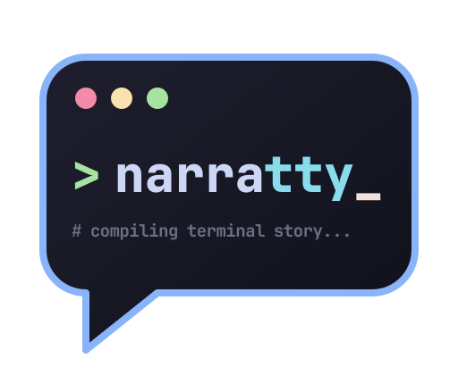

<p align="center">
  
</p>

# narratty

Turn your docs into narrated terminal videos. narratty reads a Markdown doc, speaks
its paragraphs with local text-to-speech
([Kokoro](https://github.com/thewh1teagle/kokoro-onnx) or
[Piper](https://github.com/OHF-Voice/piper1-gpl)) and runs its code blocks in a real
terminal ([VHS](https://github.com/charmbracelet/vhs)), keeping voice and picture in
sync. It runs sandboxed in Docker or Podman, or natively.

[](LICENSE)

- **One source, read or watched:** readers read the doc, others watch or listen to
  the video made from it.
- **Docs that are checked:** every command really runs; `narratty check` also compares
  what they print with the doc.
- **Videos that stay current:** change the doc, rebuild the video.

````markdown
<!-- hello.md -->
# Hello

This is a quick tour of the repository layout.

```console
$ eza --tree --level=1 .
```
````

```bash
uv tool install narratty   # or: pipx install narratty
narratty build hello.md    # writes hello.mp4
narratty build hello.md -f cast  # hello.cast + hello.mp3 + hello.html
narratty check hello.md    # runs the commands, compares their output
```

A YAML spec can point at the doc instead and add what the doc doesn't hold: an
intro, a transition between docs, hidden setup, or a demo with no doc behind it.

```yaml
# hello.narratty.yaml (narratty init --markdown hello.md writes one)
scenes:
  - markdown: hello.md
```

With Docker or Podman installed, the build runs in the `ghcr.io/ditschi/narratty`
image and needs nothing else on the host. Without one, `narratty doctor` lists the
tools native mode needs.

**Documentation:** <https://ditschi.github.io/narratty/>

## Features

- **Markdown input:** a Markdown doc becomes the video; its paragraphs are the
  narration, its code blocks run in the terminal, and tables, images and `mermaid`
  diagrams become slides.
- **Output:** an MP4, or an asciicast with narration and a player page
  (`--format cast`).
- **Local voices:** Kokoro (natural sounding, the default) or Piper
  (many languages), no cloud service. Narration and typing stay in sync, and audio is
  cached.
- **Sandboxed by default:** runs in Docker or Podman with no network unless the spec
  asks for it and you approve. The demo runs in a throwaway snapshot of your
  repository. Native mode is available too.
- **Subtitles and drafts:** SRT/VTT files, a soft track or burned-in text from the
  narration; `--draft` previews timing in seconds, without TTS.
- **Overlays:** chapter titles, file names and notes in a rounded box over the video,
  with reusable styles.
- **Browser views:** a web page or local HTML file as Chromium renders it, scrolling
  while the narration talks about it.
- **YAML scenes:** intros, transitions and demos without a doc; hidden setup scenes,
  waits for screen output, key presses and per-scene typing speed.
- **Editor layout:** a file explorer with preview above the shell
  (`terminal.layout: editor`), `focus` and `reveal` actions, and a `diff` of what the
  demo changed.
- **Demo toolkit:** bat, delta, eza, fd, ripgrep, jq, micro, yazi, file, tmux and zsh
  as static binaries, for the narratty image and, with one `COPY` line, for any dev
  container.
- **Editor support:** a JSON Schema for completion and inline errors, `validate` with
  line numbers, and shell completion.

## Development

```bash
uv sync --extra dev
uv run pre-commit install
nox                                 # all quality gates (NOX_CI=1 skips auto-formatting)
```

See the [contributor guide](docs/contributor-guide/dev-setup.md).

## License

[MIT](LICENSE)
