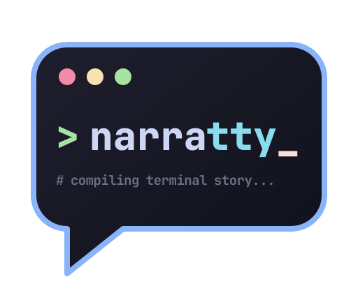

# narratty

{ width="320" }

Turn your docs into narrated terminal videos. narratty reads a Markdown doc, speaks
its paragraphs with local text-to-speech (Kokoro or Piper) and runs its code blocks
in a real terminal (VHS), keeping voice and picture in sync. It runs sandboxed in
Docker or Podman, or natively.

## Why narratty

- **One source, read or watched.** Some people like to read a doc at their own pace,
  others to watch someone use the tool or to listen while they follow along. The video
  is made from the doc itself, so everyone gets the same content, and subtitles come
  from the same text.
- **Docs that are checked.** Every command in the video really runs. `narratty check`
  runs them without recording and compares what they print with the output the doc
  shows, so CI notices when a doc no longer matches the tool.
- **Videos that stay current.** Change the doc, rebuild the video.
  `narratty compile --fingerprint` tells when a committed video is older than its doc.
- **The doc stays a doc.** Plain Markdown needs no markup. What only the video needs
  goes into HTML comments and code block attributes, invisible on GitHub and mkdocs.

A doc can be built on its own. A short YAML spec can point at it instead, and add
scenes the doc doesn't hold: an intro, a transition between docs, hidden setup, or a
demo with no doc behind it.

## Features

- **[Markdown input](user-guide/markdown.md):** a Markdown doc becomes the video; its
  paragraphs are the narration, its code blocks run in the terminal, and tables,
  images and `mermaid` diagrams become slides.
- **Output:** an MP4, or an asciicast with narration and a player page
  (`--format cast`).
- **[Local voices](user-guide/voices.md):** Kokoro (natural sounding, the default) or Piper
  (many languages), no cloud service. Narration and typing stay in sync, and audio is
  cached.
- **[Sandboxed by default](user-guide/container.md):** runs in Docker or Podman with no network unless the spec
  asks for it and you approve. The demo runs in a throwaway snapshot of your
  repository. Native mode is available too.
- **[Subtitles](user-guide/building.md#subtitles) and [drafts](user-guide/building.md#draft):** SRT/VTT files, a soft track or burned-in text from the
  narration; `--draft` previews timing in seconds, without TTS.
- **[Overlays](user-guide/spec.md#overlays):** chapter titles, file names and notes in a
  rounded box over the video, with reusable styles.
- **[Browser views](user-guide/spec.md#browser-views):** a web page or local HTML file
  as Chromium renders it, scrolling while the narration talks about it.
- **[YAML scenes](user-guide/writing-specs.md):** intros, transitions and demos without
  a doc; hidden setup scenes, waits for screen output, key presses and per-scene
  typing speed.
- **[Editor layout](user-guide/toolkit.md#editor-layout):** a file explorer with
  preview above the shell, `focus` and `reveal` actions, and a `diff` of what the demo
  changed.
- **[Demo toolkit](user-guide/toolkit.md):** bat, delta, eza, fd, ripgrep, jq, micro,
  yazi, file, tmux and zsh as static binaries, for the narratty image and, with one
  `COPY` line, for any dev container.
- **Editor support:** a JSON Schema for completion and inline errors, `validate` with
  line numbers, and shell completion.

[Examples](examples/index.md) shows each feature in a short recording.

## Quick start

Write the doc as usual:

````markdown title="hello.md"
# Hello

This is a quick tour of the repository layout.

```console
$ ls -la
```
````

Build the video, or check the doc:

```bash
uv tool install narratty   # or: pipx install narratty
narratty build hello.md    # writes hello.mp4
narratty check hello.md    # runs the commands, compares their output
```

Each scene lasts as long as its commands or its narration, whichever is longer. See
[Markdown input](user-guide/markdown.md) for what a doc can hold and how a YAML spec
adds to it, [Building a video](user-guide/building.md) for how timing works and the
[spec reference](user-guide/spec.md) for every key. `narratty init --markdown hello.md`
writes a spec for the doc, `narratty init` one with YAML scenes.

## Where it runs

| Runtime | Needs | Chosen when |
|---|---|---|
| `docker` / `podman` | the container runtime | installed (default) |
| `native` | `vhs`, `ttyd`, `ffmpeg`, `git` | no container runtime, or `--runtime native` |

`narratty doctor` checks what the selected runtime needs.
