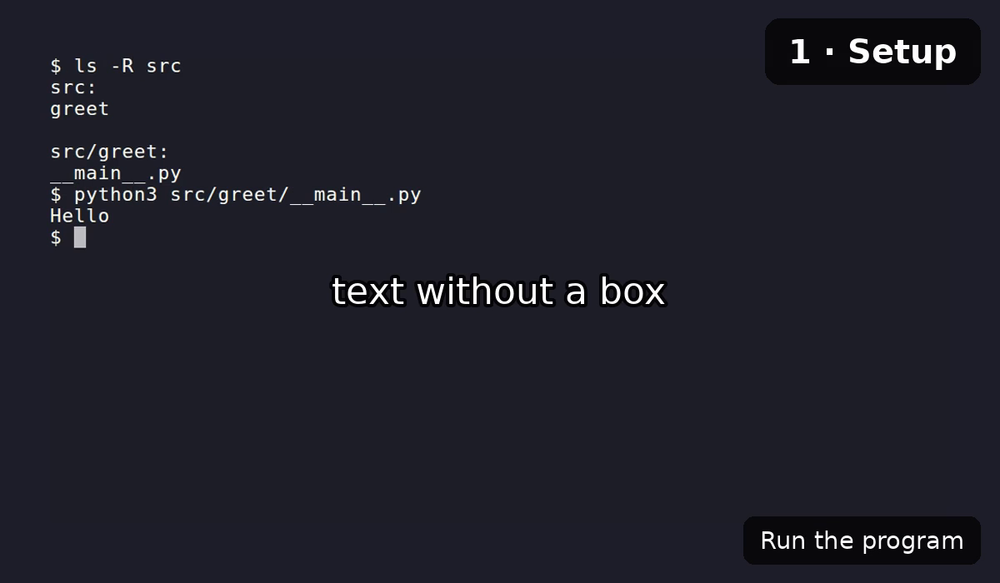
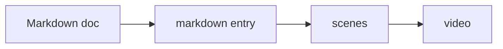
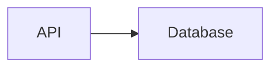

# Markdown input

Since narratty 0.5.

A Markdown doc can be the source of a video, so one file is both read and watched.
Paragraphs become the narration, code blocks become what the video types and runs.
Plain docs need no extra markup. Comments and code block attributes, both invisible
on the rendered page, change what the video does where the defaults don't fit.

This is the recommended way to use narratty. The doc stays the source: readers read
it, others watch or listen to the video. Every command runs while the video is
recorded, and `narratty check` also compares what the commands print with the doc (see
[Checking docs in CI](#checking-docs-in-ci)). A doc can be built on its own; a YAML
spec that points at it adds scenes before and after it, or combines several docs.

The video is made from this page; its spec is
[`examples/markdown/markdown.narratty.yaml`](https://github.com/ditschi/narratty/blob/main/examples/markdown/markdown.narratty.yaml).

<video controls width="100%" src="../../assets/examples/markdown.mp4"></video>

## Quick start

Write the doc as usual. This one says hello in the terminal.

````markdown title="hello.md"
# Hello

Say hello to the terminal.

```console
$ echo "Hello from Markdown"
```
````

A spec points at the doc with a `markdown` entry in its scenes. The entry turns into
ordinary scenes, so hand-written scenes can stand before and after it.

```yaml title="hello.narratty.yaml"
scenes:
  - markdown: hello.md
```

`narratty compile` prints the scenes the doc turns into. The paragraph is the
narration, and the console line is a command that runs.

```console
$ narratty compile hello.narratty.yaml
scenes:
  # from hello.md:5
  - id: hello-1
    narration: Say hello to the terminal.
    actions:
      - run: echo "Hello from Markdown"
      - wait: {prompt: true}
```

`narratty plan --sources` lists where each scene comes from, and what was left out
and why.

```console
$ narratty plan --sources hello.narratty.yaml
```

<!-- narratty: skip -->
Build the video like any other spec:

<!-- narratty: say
The video is built like any other spec. Here the command is only typed, not run.
-->

```console {narratty="no-run"}
$ narratty build hello.narratty.yaml
```

## Building a doc on its own

Since narratty 0.6.

Every command that takes a spec also takes a Markdown doc:

```bash {narratty="no-run"}
narratty build hello.md      # writes hello.mp4
narratty check hello.md      # runs the commands and compares their output
```

The doc then implies its spec: a single `markdown` entry for the whole doc. Its
commands run in a copy of the doc's git repository, from the root, or in the doc's
folder outside a repository. A `spec` comment sets other keys, those of the spec and
those of the `markdown` entry:

```markdown
<!-- narratty: spec
tts: {voice: am_michael}
heading_overlays: 2
sandbox: {network: full}
-->
```

The comment is YAML, invisible on the page like the other comments, and problems in
it are reported at their line in the doc. It cannot hold scenes, and a YAML spec that
points at the doc ignores it.

Write a YAML spec when the video needs more than the doc: scenes before or after it,
several docs, or several videos from one doc. `narratty init --markdown hello.md`
writes one to start from.

## How a doc becomes scenes

The doc is read in order. Paragraphs collect until a code block runs; then they are
the narration of the scene that runs it.

| Markdown | In the video |
|---|---|
| Paragraphs before a code block, same section | The narration of the scene that runs the block |
| Paragraphs after the last block of a section | A scene without actions; the output stays on screen |
| A block without a paragraph before it | A silent scene |
| `console` block | `$ ` lines run, `> ` lines right after them continue them; other lines are output, not typed, and compared by [`narratty check`](#checking-docs-in-ci) |
| `bash` / `sh` block | Each complete command runs (heredocs, `if`, `for` stay together); `# …` comments are not typed |
| Other language with a `title` | Written to that file (hidden), then shown with `cat` and a file overlay |
| Any language with `narratty="show"` | Shown as a highlighted code slide while the text around it is spoken; nothing is written or run (since 0.7), see [Code shown, not run](#code-shown-not-run) |
| Other language without a `title` | Left out |
| Inline code, links, emphasis | Read as plain text, so the [lexicon](voices.md#pronunciation) applies to inline code too |
| List items | Read as sentences; a code block in an item runs like any other |
| Task list items `- [ ]`, `- [x]` | Read without the box (since 0.7) |
| Footnotes `[^1]` | The marker is not read, the footnote itself not spoken (since 0.7), see [Footnotes](#footnotes) |
| Quotes and GitHub alerts (`> [!NOTE]`) | Read like paragraphs, without the `[!NOTE]` marker; `[!WARNING]`, `[!CAUTION]` and `[!IMPORTANT]` start with their type (since 0.7) |
| Admonitions `!!!` and open collapsible blocks `???+` | Read without their title; `warning`, `caution`, `danger` and `important` start with their type and title (since 0.7); code blocks inside run as usual |
| Collapsed blocks `???` and `<details>` | Left out, with everything inside |
| Content tabs `=== "…"` | One tab per tab set, see [below](#callouts-and-tabs) |
| An image on a line of its own | Shown as a [slide](spec.md#slides), titled with its alt text, while the text around it is spoken, see [Images](#images) |
| `mermaid` block | Drawn as a slide (since 0.6), see [Slides](#slides) |
| Tables | Left out; with a `table` comment spoken row by row, with a `slide` comment shown (since 0.6), see [Tables](#tables) |
| Images within text (badges), raw HTML | Left out |

Every command waits until the prompt is back, so the next one starts after it has
finished. A command that fails stops the build, as in a YAML spec; mark the block
`expect-failure` when that is the point (see [Code block attributes](#code-block-attributes)).

Scene ids are `<file stem>-<heading>-<n>`, for example `install-uv-2`; a heading
whose slug is the file stem is left out (`install-1`, not `install-install-1`). A
block with an id uses `<file stem>-<id>`, which survives edits around it.
`id_prefix` replaces the file stem.

## Callouts and tabs

Admonitions are spoken without their title, so a tip reads as part of the text.

!!! tip "Short paragraphs"
    Keep paragraphs short. Each one is a sentence or two of narration.

Warnings are different: a listener cannot see the box. Since 0.7, `warning`,
`caution`, `danger` and `important` admonitions and alerts start with their type and,
if given, their title.

!!! warning "Slow first build"
    The first build downloads the voice.

The video says "Warning: Slow first build. The first build downloads the voice."
`admonitions` in the entry changes the start per type, with a template of `{type}`,
`{title}` (the title, else the type) and `{body}`; `admonitions: false` reads every
type without a start.

```yaml
- markdown: docs/install.md
  admonitions:
    tip: "Tip: {body}"          # tips say so too
    warning: "Careful: {body}"  # instead of "Warning: <title>. <body>"
    important: "{body}"         # no start
```

Collapsed blocks are for readers only. The video leaves them out, with everything
inside, including code blocks.

??? note "Only on the page"
    This text and the command below are not part of the video.

    ```console
    $ echo "only for readers"
    ```

This is how both look in the doc.

````markdown title="callouts.md"
!!! tip "Short paragraphs"
    Keep paragraphs short. Each one is a sentence or two of narration.

??? note "Only on the page"
    This text and the command below are not part of the video.
````

Content tabs show one tab in the video: the first, or the first label the entry
lists in `tabs`. This video picks the bash tab.

=== "zsh"

    ```console
    $ echo "$ZSH_VERSION"
    ```

=== "bash"

    ```console
    $ echo "$BASH_VERSION"
    ```

Collapsible blocks that start open are spoken like admonitions. HTML `details` blocks
are left out like collapsed ones.

## Footnotes

<!-- narratty: skip -->
Since narratty 0.7.

Footnote markers are not read, and the footnotes themselves are not spoken: they are
asides for readers.[^aside] `footnotes: inline` in the entry speaks each footnote right
after the sentence that refers to it.

[^aside]: Like this one, which the video leaves out.

```markdown
The cache is shared between builds.[^1]

[^1]: Each build only adds the scenes that changed.
```

With `footnotes: inline` the video says "The cache is shared between builds. Each
build only adds the scenes that changed."

## Images

An image on a line of its own is shown as a slide while the text around it is spoken.
Its alt text is the slide's title (since 0.7); `image_titles: false` in the entry
leaves titles out, and a `slide` comment's `title` replaces it.



The image stays until the next command or heading, so it never covers what is typed.
It is embedded in the spec, which keeps it working in the sandbox without network.

Images within a sentence (such as badges), remote images and formats other than PNG,
JPEG, GIF, SVG and WebP are left out. `images: false` in the entry leaves out all images, and a
`skip` comment a single one. A `slide` comment gives it a title, see [Slides](#slides).

## Tables

<!-- narratty: skip -->
Since narratty 0.6.

A table is left out of the video unless a comment stands before it. With a `table`
comment it is shown as a slide, and its rows are spoken one by one, each highlighted
while it is spoken.

<!-- narratty: table {say: "{Step}: {Command} shows {Shows}.", title: From doc to video} -->
| Step | Command | Shows |
|---|---|---|
| Check | `narratty validate` | problems, at the Markdown file and line |
| Preview | `narratty plan --sources` | where each scene comes from |
| Build | `narratty build` | the finished video |

This is the comment that stands before the table.

```markdown
<!-- narratty: table {say: "{Step}: {Command} shows {Shows}.", title: From doc to video} -->
| Step | Command | Shows |
```

For a voiceover that does not read the cells, give `say` one phrase per row. The
snippet configures the spoken steps; the live table after it is what those steps highlight:

```markdown
<!-- narratty: table {title: Request path, say: ["The client sends a request.", "The API checks the request.", "The database stores the result."]} -->
| Step | What happens |
|---|---|
| Client | Sends a request to the API |
| API | Checks the request |
| Database | Stores the result |
```

<!-- narratty: table {title: Request path, say: ["The client sends a request.", "The API checks the request.", "The database stores the result."]} -->
| Step | What happens |
|---|---|
| Client | Sends a request to the API |
| API | Checks the request |
| Database | Stores the result |

- Without `say`, each cell is read with its header, such as "Step: Check.", and
  empty cells are left out.
- `say` fills in the cells of the columns named in braces; names match the header
  regardless of case.
- `say: ["First custom narration.", "Second custom narration."]` supplies one custom
  phrase per row; the list must have exactly as many phrases as the table has rows
  (since 0.7).
- `pause: 500ms` highlights each row that long before it is spoken.
- `title`, `theme` and `rows` set the look of the slide, as in the `slide` comment;
  `hold` keeps it up after its rows, see [How long a slide stays](#how-long-a-slide-stays).
- Cells are read like paragraphs, so the lexicon applies to inline code in them.
- A paragraph right before the comment that ends with a colon, such as "The steps
  are:", introduces the table: it is spoken with the first row, while the slide is
  shown (since 0.7). Other paragraphs are spoken before the slide appears.

A `slide` comment shows a table without reading it, while the text after it is
spoken. `rows: 8` splits a long table into pages of 8 rows; each `pause` comment in
the text after it brings up the next page, and pages left when the text ends follow
for a few seconds each.

```markdown
<!-- narratty: slide {title: All hazards, rows: 8} -->
| Hazard | Severity | Mitigation |
|---|---|---|
| … |

The first eight hazards concern the machine itself.

<!-- narratty: pause -->

The next ones concern the workplace around it.
```

## Pauses

<!-- narratty: skip -->
Since narratty 0.6.

Paragraphs that follow each other are spoken in one go, up to the next code block.
A `pause` comment ends the scene where it stands, and with a duration silence
follows.

<!-- narratty: pause 1s -->

This paragraph comes after a second of silence.

```markdown
Paragraphs that follow each other are spoken in one go.

<!-- narratty: pause 1s -->

This paragraph comes after a second of silence.
```

Without a duration, `pause` only ends the scene; the next one
follows after `timing.narration_buffer_ms`. A horizontal rule (`---`) does not end a
scene. While a table with pages is shown, a `pause` brings up its next page.

## Slides

<!-- narratty: skip -->
Since narratty 0.6.

Tables, `mermaid` blocks and images become [slides](spec.md#slides): shown full
screen while the text around them is spoken, dark unless the spec sets
`slides: {theme: light}`. GitHub draws `mermaid` blocks too, and so does mkdocs with
the `mermaid` custom fence of `pymdownx.superfences`.

<!-- narratty: slide {title: From doc to video} -->


A `slide` comment before a table, diagram or image sets its title and look; `focus`
emphasizes a Mermaid node or subgraph while the scene is narrated.

```markdown
<!-- narratty: slide {title: From doc to video, theme: light} -->
```

<!-- narratty: skip -->
| Key | Does |
|---|---|
| `title` | Text above the content |
| `theme` | `dark` or `light` for this slide |
| `rows` | Table rows per page, see [Tables](#tables) |
| `focus` | Mermaid node or subgraph ID to emphasize (since 0.7) |
| `hold` | Keeps the slide up for the text after it: `next-block` or `next-heading` (since 0.7), see [How long a slide stays](#how-long-a-slide-stays) |
| `html` | Shows an HTML file instead, from the next paragraph on |

For a voiceover walkthrough in Markdown, write the Mermaid diagram once, then use a
`focus` comment for each later step. The comment closes the previous narration scene
without adding silence. Here is the source snippet:

````markdown
<!-- narratty: slide {title: Request flow, focus: api} -->

The API receives the request.

<!-- narratty: focus db -->
The database stores it.
````

And here is the same Markdown as live content, which renders the diagram:

<!-- narratty: slide {title: Request flow, focus: api} -->

The API receives the request.

<!-- narratty: focus db -->
The database stores it.

The `focus` comment (since 0.7) closes the previous narration scene and reuses the last
Mermaid diagram with a new focus target. It takes one node or subgraph ID from the
diagram source, such as `db` or `api-gateway`. The diagram must still be on screen: a
heading, table, image, browser view or command block in between ends it. With
`narration: none` and no `say` text before it, or with `images: false`, the comment is
left out like the diagram. In YAML, repeat the slide action in one scene per focus
ID instead. A node stays emphasized for its scene's narration unless `duration_ms` caps
the slide. In a sequence diagram, `focus` takes a participant's ID, such as `C` for
`participant C as Client`, and emphasizes both of its boxes (since 0.7).

Mermaid labels can use Unicode emoji; the narratty image includes an emoji font. Its
bundled Font Awesome 6 Solid icons use the `fa:` prefix, for example `fa:server` in
Mermaid's icon syntax. Native renders can set `NARRATTY_FONTAWESOME_JSON` to an
Iconify-compatible Font Awesome `icons.json` file. The bundled icons are Font Awesome
Free by [Fonticons, Inc.](https://fontawesome.com/license/free), licensed under
[CC BY 4.0](https://creativecommons.org/licenses/by/4.0/).

Diagrams are drawn when the video is rendered, with the `mermaid.min.js` that comes
with the narratty image, so they need no network. Native renders read it from
`NARRATTY_MERMAID_JS` or from the data directory; `narratty doctor` shows where.
`images: false` leaves out diagrams too.

### How long a slide stays

A slide is shown while the text around it is spoken, up to the next block, heading or
`pause` comment; a scene after that shows the terminal again. `hold` keeps the slide
up for more of the text after it (since 0.7):

| `hold` | The slide stays for the text after it, up to |
|---|---|
| unset | the end of its scene |
| `next-block` | the next command or file block, slide, browser view or heading; `pause` comments in between keep it |
| `next-heading` | the next heading, slide or browser view; it gives way to commands while they run and comes back for the text after them |

```markdown
<!-- narratty: slide {title: Request path, hold: next-block} -->
```

A `table` comment takes `hold` too: the table stays, without a highlighted row, for
the text after its rows. In YAML, repeat the `slide` action in each scene instead.

A slide made in HTML is named with `html`, relative to the doc:

```markdown
<!-- narratty: slide {html: slides/architecture.html} -->
The architecture has three parts.
```

Like an image, the page is embedded in the spec, so it must be self-contained:
styles inline, images inline as SVG or `data:` URLs.

## Code shown, not run

<!-- narratty: skip -->
Since narratty 0.7.

A block marked `narratty="show"` is shown as a syntax-highlighted slide while the
text around it is spoken, like an image. Nothing is written or run, so it suits an
API response or a config excerpt that is not a file in the project:

The health endpoint answers with the version:

```json {narratty="show"}
{"status": "ok", "version": "0.7.0"}
```

This is its source:

````markdown
```json {narratty="show"}
{"status": "ok", "version": "0.7.0"}
```
````

`show` works with any language, also `console` (then nothing runs). A `title` becomes
the slide title, and a `slide` comment before the block sets its title and theme.

## Doc comments

HTML comments are invisible on the docs site and on GitHub. Those starting with
`narratty:` hold what only the video needs:

```markdown
<!-- narratty: skip -->
This paragraph is only for readers.

<!-- narratty: say
Narration only the video has. It may span lines.
-->

<!-- narratty: overlay {text: compose.yaml, style: file} -->

<!-- narratty: hidden
git init demo && cd demo
-->

<!-- narratty: browser {scroll: auto, duration_ms: 6s} -->
The [Compose file reference](https://docs.docker.com/compose/) lists every key.

<!-- narratty: pause 800ms -->

<!-- narratty: table {say: "{Hazard}: {Mitigation}"} -->
| Hazard | Mitigation |

<!-- narratty: slide {title: Architecture} -->

```

| Comment | Does |
|---|---|
| `skip` | Leaves the next paragraph or block out of the video; before a heading, its overlay |
| `skip-rest` | Leaves the rest of the section out, up to the next heading of the same or a higher level (since 0.7) |
| `say` | Adds narration where it stands; `skip` plus `say` replaces a paragraph |
| `overlay` | Shows an [overlay](spec.md#overlays) in the next scene; takes the same value as the action |
| `hidden` | Runs setup commands in the recorded shell without showing them |
| `browser` | Opens a link of the next paragraph in a [browser view](spec.md#browser-views), see [Opening links](#opening-links) |
| `pause` | Ends the scene; with a duration, silence follows (since 0.6), see [Pauses](#pauses) |
| `table` | Speaks the next table row by row on a slide (since 0.6), see [Tables](#tables) |
| `slide` | Sets the title and look of the next table, diagram or image, or shows an HTML file (since 0.6), see [Slides](#slides) |
| `focus` | Reuses the last Mermaid diagram, emphasizing the given node or subgraph for the next narrated step (since 0.7), see [Slides](#slides) |
| `clear` | Clears the screen (since 0.7), see [Clearing the screen](#clearing-the-screen) |
| `run` | How the next shell or console block runs: narration order, a substitute command, output lines, stopping it (since 0.7), see [Running commands](#running-commands) |
| `spec` | Spec keys for building the doc on its own (since 0.6), see [Building a doc on its own](#building-a-doc-on-its-own) |

HTML comments cannot contain `--`; put such text into a YAML scene instead.

## Opening links

Links are read as plain text. A `browser` comment opens one of them in a
[browser view](spec.md#browser-views) while its paragraph is spoken:

```markdown
<!-- narratty: browser {scroll: auto, duration_ms: 6s} -->
The [Compose file reference](https://docs.docker.com/compose/) lists every key.
```

- Without `link` it opens the first link of the next paragraph; `link: 2` opens the
  second, `link: "Compose file reference"` the one with that text. A URL instead of
  the mapping, `<!-- narratty: browser https://example.com -->`, opens that page.
- The other keys are those of the [browser action](spec.md#browser-views): `scroll`,
  `duration_ms` and `load_ms`.
- The paragraph starts a new scene, so the page appears with it. Like an image, the
  page stays until the next command or heading at the latest.
- A relative link to another page of the docs (`../user-guide/spec.md#overlays`)
  opens the published page: `site_url` from `mkdocs.yml` plus the page's path.
- Web pages need network access: in the container that is
  `sandbox: {network: full}` or an allowlist.

## Code block attributes

An id and per-block options go into one attribute list after the language. mkdocs
uses the id as a link anchor and ignores `narratty`; GitHub ignores both.

````markdown
```console {#install narratty="no-run"}
$ uv tool install narratty
```

```yaml {#spec title="demo.narratty.yaml"}
scenes: []
```
````

`narratty="…"` takes space-separated options:

| Option | Does |
|---|---|
| `no-run` | Types the command and leaves it on screen without running it; before 0.7 it was cancelled with a visible `^C` |
| `hidden` | Runs the block without showing it (setup) |
| `expect-failure` | The block's commands are expected to fail |
| `any-output` | The output the block shows is not compared (since 0.6), see [Checking docs in CI](#checking-docs-in-ci) |
| `show` | Shows the block as a code slide instead, see [Code shown, not run](#code-shown-not-run) (since 0.7) |
| `say=…`, `instead=…`, `lines=…`, `until=…`, `then=…`, `timeout=…` | The keys of the `run` comment (since 0.7), see [Running commands](#running-commands) |

!!! warning "Write attributes in braces"
    mkdocs renders `console narratty="no-run"` (without braces) as plain text. A
    brace-less `title="…"` works on its own, but not together with an id.

## Running commands

Since narratty 0.7.

A `run` comment right before a shell or console block says how the video runs it.
The block stays what readers copy.

```markdown
<!-- narratty: run {say: before, lines: 10} -->
```

The same keys fit in the block's attributes as `key=value`, quoted like in the shell
when the value has spaces. Where both are given, the attribute wins.

````markdown
```console {narratty="instead='pip install -e .' lines=10"}
$ pip install tally
```
````

| Key | Does |
|---|---|
| `say` | When the text is spoken: `before`, `during` (default) or `after` the commands, see [Explain, then run](#explain-then-run) |
| `instead` | Shows the block's command, runs this one, see [Show one command, run another](#show-one-command-run-another) |
| `lines` | Shows only that many lines of each command's output, see [Long output](#long-output) |
| `until` | Waits for this regular expression on screen, then stops the last command, see [Commands that keep running](#commands-that-keep-running) |
| `then` | The key that stops it: `C-c` (default) or a key such as `q` |
| `timeout` | How long `until` waits (default `30s`) |

### Explain, then run

| `say` | The video | Narration |
|---|---|---|
| `during` (default) | Speaks while the commands are typed and run | The text before the block |
| `before` | Speaks first, then types the commands | The text before the block |
| `after` | Runs the commands, then speaks, in the same scene | The text after the block, up to the next block, heading or `pause`; the text before it is spoken on its own first |

`say: before` on the `markdown` entry makes it the default for every block; a `run`
comment with `say: during` changes it back for one. In YAML, `before` is a `hold: auto`
before the first action and `after` is `narration_start: after_actions`.

<!-- narratty: run {say: after} -->
```console
$ echo "Hello from Markdown"
Hello from Markdown
```

The video printed the greeting before this paragraph was spoken.

```markdown
<!-- narratty: run {say: after} -->
```

### Show one command, run another

`instead` shows the reader's command and runs another one in its place: the reader's
`pip install tally` can stay in the doc while the video installs from the checkout.

````markdown
<!-- narratty: run {instead: "pip install -e ."} -->
```console
$ pip install tally
```
````

- The block's command is typed, then replaced unseen, and the screen shows it with the
  output of the command that ran. No `^C` and no second command appear.
- The block must have one command, and `instead` must fit on one line. The block's
  command may contain placeholders such as `<package>`, since it does not run.
- `narratty check` runs the `instead` command and does not compare its output with
  the output the block shows, which belongs to the reader's command.
- A `no-run` block runs nothing in its place: its command is typed and stays on
  screen. To say so in the video, add an `overlay` comment, such as
  `<!-- narratty: overlay not run in this video -->`.

### Long output

`lines: 10` shows the first ten lines of each command's output and ends it with
`... (N more lines)`. The block keeps the output readers see, `...` included:

````markdown
<!-- narratty: run {lines: 3} -->
```console
$ seq 100
1
2
...
```
````

- `narratty check` runs the command as it is and compares all of its output with the
  block.
- In the video the output goes through `awk`. The command then writes to a pipe
  instead of a terminal, so programs that colour their output only in a terminal print
  it plain, and stderr is merged into stdout. Commands must fit on one line.

### Commands that keep running

`until` waits for a pattern in the output, then stops the block's last command, by
default with Ctrl+C, and waits for the prompt. Servers and `tail -f` stay in the doc as
readers type them.

````markdown
<!-- narratty: run {until: "Serving HTTP", timeout: 20s} -->
```console
$ python -m http.server 8000
Serving HTTP on 0.0.0.0 port 8000 (http://0.0.0.0:8000/) ...
...
```
````

- The pattern is a regular expression, matched against the whole screen, so pick one
  the screen does not show before the command prints it.
- `then: q` stops a pager with a key instead; keys are those of the
  [`key` action](spec.md#actions), `C-…` is a Ctrl chord.
- `narratty check` waits and stops the command the same way. The exit code of a
  command stopped with Ctrl+C does not count as a failure. Its output ends with what
  the command prints when stopped, so end the block's output with `...`.

## Clearing the screen

Since narratty 0.7.

The screen keeps what earlier commands printed. A `clear` comment clears it where it
stands, so the text after it does not play over old output:

```markdown
<!-- narratty: clear -->
```

`clear_on: 2` on the `markdown` entry clears it where each heading of level 2 or
higher starts a section. The screen is cleared when the next visible scene starts,
together with its [heading overlay](#heading-overlays), also after a `hidden` block.
Clearing presses Ctrl+L, which runs no command, so exit codes are checked as before;
`shell: sh` has no line editing and cannot clear this way.

## Placeholders

Write placeholders as environment variables, which readers can set and copy:

```markdown
$ narratty build "$SPEC" --var target="$TARGET"
```

The video types `$SPEC` as written, so values, including secrets, never appear on
screen. The value comes from [`sandbox.env`](spec.md#sandbox), from
`sandbox.env_passthrough` (you set it on the host) or from a `hidden` comment with an
`export`. A command to run that still contains a placeholder like `<url>` is an
error with the hint to write it as `$URL`.

## The `markdown` entry

A YAML spec decides everything at section level and above: which docs, which sections
and in what order, the narration rule and the overlays. Several videos from one doc
are several YAML files.

```yaml
narration: all                      # default for every markdown entry
scenes:
  - markdown: docs/environments.md
    sections: [images, compose]     # nested headings included; unset = whole doc
    heading_overlays: 3
  - id: outro
    narration: That's all you need to get started.
  - markdown: docs/building.md
    narration: none                 # only `say` comments are spoken
    heading_overlays: {levels: 3, breadcrumb: true}
    defaults: {typing_speed_ms: 40}
    overrides:
      install:                      # the block {#install}
        narration: Install it with uv.
        fast: true
        before: [{overlay: "pipx works too"}]
```

| Key | Default | Meaning |
|---|---|---|
| `markdown` | required | The doc, relative to the spec |
| `sections` | whole doc | Headings by TOC slug or title; a list path such as `[compose, services]` picks one of several equal headings; `{include: [...], exclude: [...]}` also leaves sections out (since 0.7), see [Choosing sections](#choosing-sections) |
| `narration` | spec's `narration` (`all`) | `all` speaks every paragraph, `none` only `say` comments |
| `tabs` | `[]` | Preferred content tab labels; otherwise each tab set's first tab |
| `heading_overlays` | none | Show headings down to this level, see [Heading overlays](#heading-overlays) |
| `file_titles` | `true` | Show a file block's title as an overlay |
| `images` | `true` | Show images on a line of their own and `mermaid` blocks, see [Images](#images) |
| `id_prefix` | file stem | Start of the generated scene ids |
| `clear_on` | none | Clear the screen where a heading of this level or higher starts a section (since 0.7), see [Clearing the screen](#clearing-the-screen) |
| `say` | `during` | When the text before a block is spoken: `before` its commands are typed, or `during` them (since 0.7), see [Explain, then run](#explain-then-run) |
| `check_output` | `true` | Let `narratty check` compare the output console blocks show, see [Checking docs in CI](#checking-docs-in-ci) (since 0.6) |
| `footnotes` | `skip` | `inline` speaks each footnote after the sentence that refers to it, see [Footnotes](#footnotes) (since 0.7) |
| `admonitions` | `{}` | Per type, how admonitions and alerts start, or `false`, see [Callouts and tabs](#callouts-and-tabs) (since 0.7) |
| `image_titles` | `true` | Use an image's alt text as its slide title, see [Images](#images) (since 0.7) |
| `lint` | `true` | Let `narratty validate` warn about the doc, see [Checking the result](#checking-the-result) (since 0.7) |
| `defaults` | `{}` | Scene keys for every scene: `typing_speed_ms`, `pause_ms`, `fast`, `timelapse`, `narration_start`, `expect_exit` |
| `overrides` | `{}` | Per block id: the same scene keys plus `narration` and `before` / `after` action lists |

A missing section or an override for an id that is not in the doc is an error with
a "did you mean".

### Choosing sections

A list of sections picks them, in that order, with their nested headings. To leave
out a section but keep the rest, intro included, exclude it (since 0.7):

```yaml
- markdown: CONTRIBUTING.md
  sections: {exclude: [faq, troubleshooting]}
- markdown: docs/guide.md
  sections: {include: [install, usage], exclude: [windows]}  # usage without its windows part
```

Inside the doc, a `<!-- narratty: skip-rest -->` comment leaves out the rest of its
section, up to the next heading of the same or a higher level. Transitions between docs are ordinary scenes, for example a hidden
`run: cd other && clear` and a scene with an overlay.

## Heading overlays

`heading_overlays: N` shows the headings down to level `N`, each level in its own
built-in style: `heading-1` is a title card in the centre, deeper levels appear at the
top right and fade after a few seconds. `{levels: N, breadcrumb: true}` shows levels 2
to `N` as one overlay instead, `Environments › Compose › Services`, which stays while
its section plays. Long breadcrumbs shorten their middle parts to `…` first
(`max_length`, default 50); `separator` changes the ` › `.

| Style | `position` | `size` | `bold` | `duration_ms` |
|---|---|---|---|---|
| `heading-1` | `center` | `large` | yes | `2.5s` |
| `heading-2` | `top-right` | `large` | yes | `3s` |
| `heading-3` | `top-right` | `medium` | no | `3s` |
| `heading-4` and deeper | `top-right` | `small` | no | `2.5s` |
| `breadcrumb` | `top-right` | `small` | no | until the section ends |
| `file` | `top` | `small` | no | until the scene ends |

Change them like any style in [`overlay_styles`](spec.md#overlays).

## Snippets and mkdocs

The doc is read the way this repo's mkdocs config renders it: admonitions,
collapsible blocks and content tabs (`pymdownx.tabbed`) as above, and
`--8<-- "path"` snippets (with an optional `:start:end` line range) inserted before
reading, relative to the snippets `base_path` in the nearest `mkdocs.yml`, else the
repository root. Errors in an inserted snippet name the snippet file and line.
Headings with an id (`## Title {#custom}`) are selected by that id.

Block snippets (`--8<--` on a line of its own), URL snippets and named snippet
sections are not supported and are reported as errors.

## Checking the result

`narratty validate` reports problems at the Markdown file and line. Since 0.7 it also
warns, on stderr and without failing, about what expands fine but is likely not what
the author meant:

| Warning | Fix |
|---|---|
| No command runs in the video | Label command blocks `console` (with `$ ` prompts), `bash` or `sh` |
| A left-out block has `$ ` lines | Label it `console`, or mark it `narratty="show"` |
| A table is left out | A `table` or `slide` comment, or `skip` to leave it out on purpose |
| Output shown looks like an error (`error:`, `Error`, `fatal:`, a Python traceback) | Mark the block `expect-failure` if the command is meant to fail |
| A `focus` ID is not in the diagram (flowcharts and sequence diagrams) | Use an ID from the source; the warning suggests the closest |
| Narration says "above", "below", "click here" or "the following command" | Say what is meant; listeners cannot see the page |

`lint: false` on the entry, or in the doc's `spec` comment, turns the warnings off.
`narratty plan --sources SPEC` lists every scene with the Markdown line it comes from,
and what was left out and why. `narratty compile SPEC` prints the spec with every
`markdown` entry replaced by its scenes: a way out of Markdown input, or a frozen copy
to build from.

Sandboxed runs only mount the spec file into the container, so they get the expanded
spec; the Markdown docs stay on the host.

## Checking docs in CI

Since narratty 0.6.

`narratty check` runs the doc's commands the way the video would, without recording,
voice or end card. It fails when a command fails (exit code 7) or prints something
else than the doc shows (exit code 8), with a diff:

```bash {narratty="no-run"}
narratty check docs/install.md
```

In a console block, the lines after a `$ ` command, up to the next one, are what it
prints:

```console
$ echo "Hello from Markdown"
Hello from Markdown
```

- Colours, trailing spaces and blank lines at the start and end do not count.
- A line `...` stands for any lines, also none; `...` within a line for any text,
  as in `Python 3...`.
- A command without output lines in the doc runs, but its output is not compared.
- `narratty="any-output"` on a block, or `check_output: false` on the entry, turns
  the comparison off.
- Builds check exit codes, but do not compare output.

The comparison is the `run` action's [`expect_output`](spec.md#expected-output), which
`narratty compile` shows. `narratty compile SPEC --fingerprint` tells when a
committed video is older than its doc.

## Not supported yet

- Comparing output in the editor layout.
- Narration rules beyond `all` and `none`.
