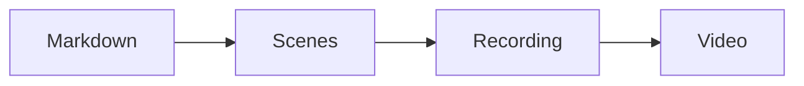

# How narratty builds a video

A narratty video starts as an ordinary Markdown doc. Nothing in it is written for the
video alone, so the same file is read on the page and watched as a video.

## The stages

Every build goes through four stages:

- The doc is parsed into paragraphs, code blocks, tables and diagrams.
- Each paragraph becomes narration, spoken by a local voice.
- Each command block runs in a real terminal while VHS records it.
- Slides, overlays and the narration are laid over the recording.



The diagram is drawn when the video is rendered, from the same source the page shows.

## The look

Slides are plain HTML, so a CSS file decides how they look. This example uses its own
theme, and gives the terminal the same colours, so terminal and slides look alike.

The theme is a short CSS file:

```console
$ head -3 theme.css
/* A night-blue theme for narratty slides */
section { background: #0f2233; color: #e6edf3; }
section h1 { color: #7cc4ff; }
```

The heading stays in place while the rest of the picture changes, because the frame
keeps it there for the whole section.
