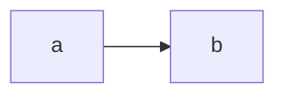

# Prose

Since 0.8.

This paragraph is long enough to get a slide of its own (it explains the setup), so the
terminal is not idle while it is spoken. It has a second sentence.

The last paragraph before a block introduces it:

```console
$ echo hi
```

## Lists

Check these before you start:

- The [power supply](power.md) is off, and the board is unplugged.
- The cable is in `USB0`.

<!-- narratty: say
A say comment is spoken too. It gets a key point.
-->

## Code

A spec comment sets keys:

```yaml
tts: {voice: am_michael}
```

The comment is YAML, invisible on the page.

Write a YAML spec when the video needs more than the doc, for example scenes before it.

## Diagram

The build has three stages:

- Parse the doc into blocks and paragraphs.
- Record the commands in a terminal.



The diagram follows the stages.
